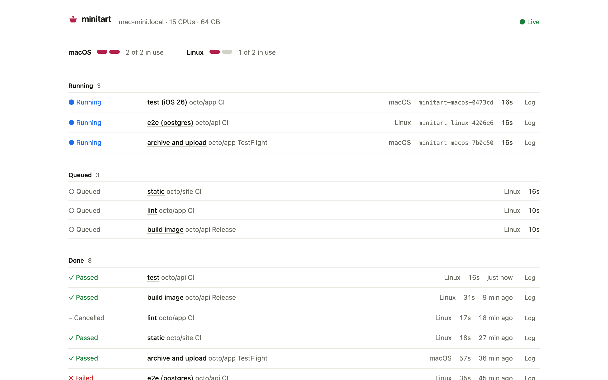

# minitart

**GitHub Actions runners on your own Mac mini.** minitart runs every job in a fresh virtual
machine and deletes it when the job ends. A job reaches the internet and nothing of yours:
not your files, not your keychain, not your home network.

It is a very small manager, with a dashboard, on top of three things other people maintain:
Apple's hypervisor, [Tart](https://tart.run) and GitHub's own runner. It is for one person
with one Mac and a handful of private repos. [minitart.rovira.sh](https://minitart.rovira.sh)



> **Designed, being built.** These docs describe the design. The manager and its dashboard
> are in review in the first pull request, and nothing is usable from `main` yet.

## What you get

- **macOS and Linux jobs on the same Mac.** Up to two macOS VMs (Apple's limit) and as many
  Linux VMs as the memory holds. Linux VMs have Docker.
- **A clean machine for every job.** A VM is cloned in under a second, runs one job, and is
  deleted.
- **A network that is an allowlist.** A VM can send to public internet addresses and nowhere
  else. Your router, your NAS and your tailnet are out of reach without being listed.
- **GitHub holds the list of repos.** minitart is a GitHub App you create in one click and
  install on the repos you choose. Public repos are skipped.
- **Nothing to configure by hand.** No config file. VM counts start from what the Mac can
  hold and change in the dashboard.
- **A dashboard**: what is queued, running and done, with logs.
- **Small enough to read.** TypeScript that Node runs as it is; no build, no runtime
  dependencies.

## Use it in a workflow

```yaml
jobs:
  test:
    runs-on: minitart-linux # or minitart-macos
```

To switch between your Mac and GitHub's runners without editing workflows:

```yaml
runs-on: ${{ vars.RUNNER_LINUX || 'ubuntu-latest' }}
```

Set the repository variable `RUNNER_LINUX` to `minitart-linux` to use the Mac. Delete it to
go back.

## Set it up

You need an Apple silicon Mac on macOS 26 or newer, Node 24 or newer, and Homebrew.

```bash
brew install openai/tools/tart openai/tools/softnet
git clone https://github.com/zurfyx/minitart && cd minitart

node src/main.ts doctor              # says what is missing, and the command that fixes it
node src/main.ts image build linux   # under a minute
node src/main.ts image build macos   # downloads tens of gigabytes the first time
node src/main.ts selftest            # boots a VM and checks what it can reach
node src/main.ts start               # the manager, and the dashboard at 127.0.0.1:4141
```

`doctor` will ask for two things that need `sudo`, once: letting Softnet (the network
filter) run as root, and stopping the Mac from sleeping.

Then open <http://127.0.0.1:4141> on the Mac, click **Create the GitHub App**, and on
GitHub choose "Only select repositories" and pick yours. Jobs with a minitart label start
running.

To keep it running across restarts:

```bash
node src/main.ts service install     # a LaunchAgent: starts at login, restarts if it stops
```

The Mac has to stay logged in: turn on automatic login.

## What it does not do

- **No fallback.** If the Mac is off or asleep, jobs wait in GitHub's queue.
- **No x86.** Linux VMs are arm64. Jobs that need x86 stay on `ubuntu-latest`.
- **No caches between jobs.** Use `actions/cache`, or put what every job needs in the image.
- **No secrets from the Mac.** A job gets its secrets from GitHub, as on a hosted runner.
- **No fleets.** One Mac.

## Read more

- [Product](docs/product.md): what it is and what it promises
- [Architecture](docs/architecture.md): how it works, in one page
- [Security](docs/security.md): what a job can and cannot do, and what is not covered
- [Decisions](docs/decisions/README.md): every consequential choice, with its reasons

## Licence

MIT. Tart and Softnet have their own licences (source-available; free for this use).
