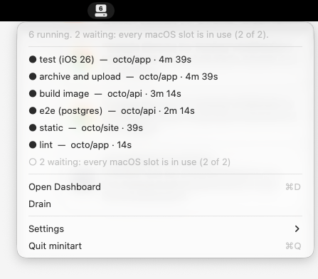

# minitart

**GitHub Actions runners on your own Mac mini.** minitart runs every job in a fresh virtual
machine and deletes it when the job ends. A job reaches the internet and nothing of yours:
not your files, not your keychain, not your home network.

It is a very small manager, with a dashboard, on top of three things other people maintain:
Apple's hypervisor, [Tart](https://tart.run) and GitHub's own runner. It is for one person
with one Mac and a handful of private repos.
[minitart.rovira.sh](https://minitart.rovira.sh)

<picture>
  <source srcset="site/dashboard-dark.png" media="(prefers-color-scheme: dark)" />
  
</picture>

> minitart runs its author's CI on a Mac mini. Read [the security model](docs/security.md),
> and the code, before you trust it with yours.

## What you get

- **macOS and Linux jobs on the same Mac.** Up to two macOS VMs (Apple's limit) and up to 26
  Linux VMs, as many as the memory holds. Linux VMs have Docker.
- **A clean machine for every job.** A VM is cloned in under a second, runs one job, and is
  deleted.
- **A network that is an allowlist.** A VM can send to public internet addresses and nowhere
  else. Your router, your NAS and your tailnet are out of reach without being listed.
- **You choose the repos twice.** minitart is a GitHub App you create in one click and
  install on repos; a repo is served once you also turn it on in the dashboard. Installing
  the App on your whole account by mistake serves nothing. Public repos are skipped unless
  you turn them on.
- **Nothing to configure by hand.** No file to write. VM counts start from what the Mac can
  hold and change in the dashboard, which saves them as plain JSON you can back up.
- **A dashboard**: one line that says what needs you, a timeline of the last hour's VMs, the
  Mac's CPU, memory and disk, and every job of the past year, with its log while GitHub
  keeps it. On the Mac itself, or on your Tailscale tailnet if you want it there, and as an
  app in the Dock or on a phone. A Usage view counts the minutes run, with other providers'
  list prices beside them for reference.
- **In the menu bar, if you want it.** `brew install --cask zurfyx/tap/minitart-app` adds a
  menu bar app that shows whether minitart is busy or needs you, and installs minitart with
  it.
- **Small enough to read.** TypeScript that Node runs as it is; no build, no runtime
  dependencies.

## Use it in a workflow

```yaml
jobs:
  test:
    runs-on: minitart-linux # or minitart-macos
```

To switch between your Mac and GitHub's runners without editing workflows:

```yaml
runs-on: ${{ vars.RUNNER_LINUX || 'ubuntu-latest' }}
```

Set the repository variable `RUNNER_LINUX` to `minitart-linux` to use the Mac. Delete it to
go back.

## Set it up

You need an Apple silicon Mac on macOS 26 or newer, and Homebrew, which brings Node (from a
checkout you need Node 24 or newer). The short version is below;
[docs/setup.md](docs/setup.md) is the full one, step by step, with how to tell each step
worked and which three need you in person.

### 1. Install: pick one

**The command line and the dashboard.** Everything minitart is, run from Terminal and
watched in the browser:

```bash
brew install zurfyx/tap/minitart
```

**The same, with a menu bar app.** One command installs minitart and a Mac app for it that
lives in the menu bar:

```bash
brew install --cask zurfyx/tap/minitart-app
```

Its mark says how things are: a prompt when idle, the number of jobs running, an exclamation
mark when minitart needs you, and a pause sign while it drains. Its menu says what the
dashboard's headline says, lists the jobs running, opens the dashboard, drains and resumes,
and offers to start minitart, finish the setup or upgrade it when one is due.



### 2. Get the Mac ready

The same either way, in Terminal:

```bash
minitart doctor --fix        # installs Tart and Softnet, and does what needs your password
minitart image build linux   # about a minute
minitart image build macos   # downloads tens of gigabytes the first time
minitart selftest            # boots a VM and checks what it can reach
```

`doctor --fix` installs what is missing and asks for your password once, for three things:
letting Softnet (the network filter) run as root, a firewall rule that keeps VMs off the
Mac's own services, and stopping the Mac from sleeping. `minitart doctor` alone only looks,
and prints the command for each. The menu bar app's **Finish setup in Terminal** runs the
same `doctor --fix`.

### 3. Start it

```bash
brew services start minitart     # starts at login, restarts if it stops
```

With the menu bar app, **Start minitart** in its menu does the same. `minitart start` runs
it in the foreground instead, until you stop it.

### 4. Connect GitHub

Open <http://127.0.0.1:4141> on the Mac (or **Open Dashboard** in the menu), click **Create
the GitHub App**, and on GitHub choose "Only select repositories" and pick yours. Back in
the dashboard, under **This Mac**, click **Serve** on each. Jobs with a minitart label start
running.

### Keeping it up

To upgrade, `minitart upgrade`: it waits for running jobs, upgrades minitart, Tart and
Softnet together (and the menu bar app, if you have it), and asks for your password once to
put Softnet's permission back.

The Mac has to stay logged in. After a restart nothing runs until someone logs in, unless
automatic login is on, and that needs FileVault off. Which you prefer is yours to choose;
`doctor` tells you where you stand.

### What a job starts with

The Linux image is Ubuntu with Docker and a 50 GB disk. The macOS image is Cirrus Labs' base
image, which has no Xcode. For iOS and macOS builds, start from one that does:

```bash
minitart image build macos --from ghcr.io/cirruslabs/macos-tahoe-xcode:latest
```

Rebuild an image when `doctor` says its runner has fallen behind: GitHub stops accepting old
runner versions a few weeks after a new one is out.

### When jobs do not start

- **The dashboard says a VM failed to start.** Look in **Activity**, on the **This Mac**
  view: the warning for that VM ends with what Tart said. A third macOS VM is refused by
  macOS itself, and that includes a macOS VM of your own, or an image being built.
- **"Its runner never reached GitHub."** The VM booted and could not get out. A VPN on the
  Mac with a small MTU (an exit node, a corporate VPN) stalls TLS inside VMs.
- **Nothing happens at all.** `minitart doctor`.

## What it does not do

- **No fallback.** If the Mac is off or asleep, jobs wait in GitHub's queue.
- **No x86.** Linux VMs are arm64. Jobs that need x86 stay on `ubuntu-latest`.
- **No caches between jobs.** Use `actions/cache`, or put what every job needs in the image.
- **No secrets from the Mac.** A job gets its secrets from GitHub, as on a hosted runner.
- **No fleets.** One Mac.

## Read more

- [Product](docs/product.md): what it is and what it promises
- [Architecture](docs/architecture.md): how it works, in one page
- [Security](docs/security.md): what a job can and cannot do, and what is not covered
- [Decisions](docs/decisions/README.md): every consequential choice, with its reasons

## Licence

MIT. Tart and Softnet have their own licences (source-available; free for this use).
